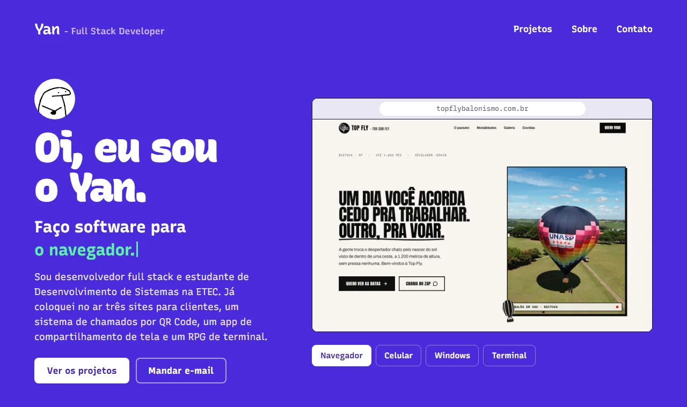

# Portfólio do Yan

Site pessoal com os meus projetos: três sites no ar para clientes, um sistema de chamados por QR Code, um app de compartilhamento de tela e um RPG de terminal.



## O que tem no site

- **Abertura** com uma vitrine que alterna entre os quatro tipos de tela para os quais desenvolvo: navegador, celular, Windows e terminal.
- **Projetos**, cada um na moldura da plataforma onde roda, com capturas reais e as tecnologias usadas:
  - [QVT360°](https://qvt360.com.br), plataforma de saúde e segurança do trabalho;
  - [Top Fly Balonismo](https://topflybalonismo.com.br), site de voos de balão;
  - [Boituva Fitness Fair](https://boituvafitnessfair.com.br), site oficial da feira;
  - MGRCall, chamados de manutenção por QR Code (TCC em equipe);
  - [MGRScreen](https://github.com/YanGDBr/MGRScreen), compartilhamento de tela e áudio;
  - [Wyrdfall](https://github.com/YanGDBr/Wyrdfall), RPG roguelike de terminal.
- **Resumo** dos seis projetos em uma tabela, com stack, plataforma e situação.
- **Sobre mim** e **contato** por WhatsApp, e-mail e GitHub.

## Como rodar

O site é estático, feito com HTML, CSS e JavaScript, sem etapa de build e sem dependências.

Basta abrir o `index.html` no navegador. Para servir por HTTP, com o [Node.js](https://nodejs.org) instalado:

```bash
npx serve .
```

## Estrutura

```text
index.html      conteúdo da página
styles.css      visual, layout responsivo e animações
script.js       vitrine da abertura, troca de capturas, animações ao rolar e botão de copiar
assets/
  yan.jpg       foto de perfil
  preview.webp  imagem usada neste README
  shots/        capturas de tela dos projetos
  icons/        ícones das tecnologias
```

## Como editar

- **Textos e projetos:** ficam no `index.html`. Cada projeto é um `<article class="projeto">`.
- **Capturas:** troque os arquivos em `assets/shots/` mantendo os nomes, ou ajuste o `src` das imagens.
- **Tecnologias:** cada etiqueta é um `<li>` dentro de `<ul class="tecnologias">`, com um ícone de `assets/icons/`.
- **Cores e tipografia:** as variáveis ficam no começo do `styles.css`, em `:root`.

As animações respeitam a preferência de movimento reduzido do sistema, e todo o conteúdo aparece mesmo sem JavaScript.

## Créditos

- Tipografia [Recursive](https://www.recursive.design), sob a SIL Open Font License, carregada pelo Google Fonts.
- Ícones de tecnologias do [Devicon](https://devicon.dev) (MIT) e do [Simple Icons](https://simpleicons.org) (CC0).

## Licença

O código deste repositório (HTML, CSS e JavaScript) está sob a [licença MIT](LICENSE).

A licença não cobre o conteúdo: os textos sobre mim, a foto de perfil e as capturas de tela dos projetos. Os logotipos e marcas que aparecem nas capturas e nos ícones pertencem aos seus respectivos donos.
